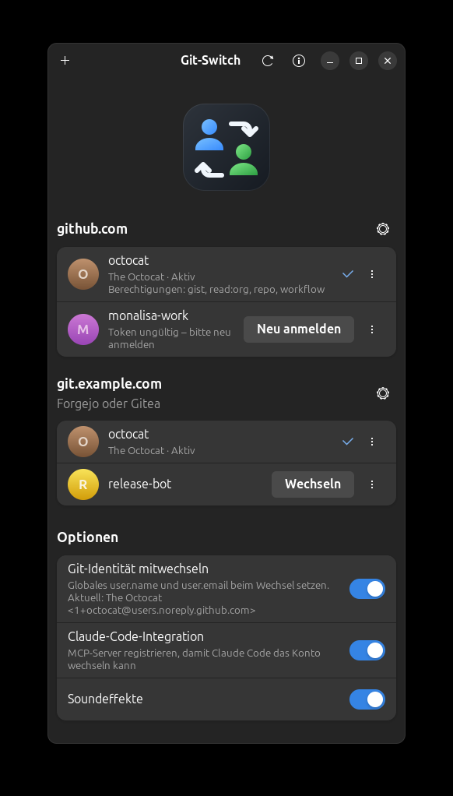

<p align="center">
  
</p>

<h1 align="center">Git-Switch</h1>

<p align="center">
  Mit einem Klick zwischen GitHub-CLI-Konten wechseln.<br>
  <a href="README.md">English</a> · <b>Deutsch</b>
</p>

<p align="center">
  
</p>

Eine kleine GTK-App rund um `gh auth switch`: Sie zeigt alle Konten, mit denen
die [GitHub CLI](https://cli.github.com) angemeldet ist, und wechselt mit einem
Klick zwischen ihnen – im Fenster, auf der Kommandozeile oder aus Claude Code
heraus über den mitgelieferten MCP-Server.

## Funktionen

- Listet alle Konten pro Host mit Avatar, Aktiv-Markierung und Live-Prüfung,
  ob das gespeicherte Token noch funktioniert
- Wechsel mit einem Klick (`gh auth switch`)
- Konten über einen geführten Dialog hinzufügen: GitHub.com, GitHub Enterprise
  oder ein Forgejo-/Gitea-Server, Anmeldung im Browser oder mit Zugriffstoken –
  ganz ohne Terminal
- Forgejo- und Gitea-Konten mit denselben Schutzmaßnahmen, die gh für
  GitHub-Tokens anwendet (siehe unten)
- Einzelne Konten abmelden
- Zeigt die Berechtigungen (Scopes) jedes Tokens; hinzufügen oder entfernen per
  Häkchen in einer Liste mit Beschreibungen (`gh auth refresh`)
- Token eines Kontos in die Zwischenablage kopieren (`gh auth token`)
- Pro Host: HTTPS oder SSH als Git-Protokoll wählen und gh als
  Git-Anmeldehelfer einrichten (`gh auth setup-git`)
- Optional: globales git `user.name` / `user.email` folgt dem aktiven Konto
  (verwendet die GitHub-noreply-Adresse des Kontos)
- Übernimmt Änderungen von außen (`gh` CLI, MCP-Server) sofort
- MCP-Server, damit Claude Code Konten auflisten und wechseln kann
- Leak-Prüfung: findet Tokens, Adressen eigener Server, die echte
  E-Mail-Adresse und ähnliche private Daten, bevor sie veröffentlicht werden
  (siehe unten)
- Sucht beim Start nach einer neueren Version, im Fenster und im MCP-Server
- Dezente Soundeffekte für Wechsel, Anmeldung und Fehler (abschaltbar)
- Oberfläche auf Deutsch und Englisch

GitHub-Konten werden über die GitHub CLI verwaltet, Forgejo- und Gitea-Konten
verwaltet Git-Switch selbst. GitLab wird nicht unterstützt.

## Installation

Benötigt `gh` ≥ 2.40, `git`, Python ≥ 3.10, GTK 4 und libadwaita ≥ 1.4.
Forgejo-/Gitea-Konten brauchen zusätzlich libsecret und einen laufenden
Schlüsselbund (GNOME Keyring, KWallet o. Ä.).

**Debian / Ubuntu / Linux Mint** – das `.deb` von der
[Release-Seite](../../releases) herunterladen und installieren:

```bash
sudo apt install ./gitswitch_0.5.1_all.deb
```

**Andere Distributionen** – PyGObject, GTK 4 und libadwaita über den
Paketmanager installieren, dann:

```bash
pipx install --system-site-packages gitswitch-0.5.1-py3-none-any.whl
```

**Aus dem Quellcode** – `python3 -m gitswitch` in einem Checkout.

## Benutzung

```bash
gitswitch                 # Fenster öffnen
gitswitch list            # Konten als JSON
gitswitch switch <user>   # Wechsel aus der Shell
gitswitch leak-check      # prüfen, was der nächste Push veröffentlichen würde
```

Die Sprache richtet sich nach der Systemsprache.

## Forgejo und Gitea

Im Dialog „Konto hinzufügen“ **Forgejo oder Gitea** wählen, die Serveradresse
eingeben und ein Zugriffstoken einfügen (Berechtigungen `read:user` und
`write:repository`). Den Kontonamen liest Git-Switch vom Server, mehr ist nicht
einzutippen.

Tokens werden so behandelt, wie gh es mit GitHub-Tokens macht:

- Ein Token liegt ausschließlich im System-Schlüsselbund – nie in einer Datei,
  in der Git-Konfiguration, in einer Kommandozeile oder in einem Log. Ohne
  Schlüsselbund wird das Konto nicht angelegt; es gibt keinen
  Klartext-Ausweg.
- git erhält es über einen Anmeldehelfer (`gitswitch git-credential`), der nur
  für diesen einen Host eingerichtet wird. Er beantwortet nur HTTPS-Anfragen
  für genau diesen Host, mit dem Token des aktiven Kontos.
- Git-Switch sendet ein Token nur an den eigenen Server, nur über HTTPS, und
  folgt dabei keinen Weiterleitungen.
- Tokens werden weder im Fenster angezeigt noch von Kommandozeile oder
  MCP-Server ausgegeben.
- Mit **Git-Identität mitwechseln** wird die Adresse `login@noreply.<host>`
  verwendet, nicht deine echte. Nutzt dein Server eine andere No-Reply-Domain,
  werden Commits lediglich nicht dem Konto zugeordnet.

Ein Benutzername in der Remote-URL (`https://name@git.example.com/…`) wählt
für dieses Repository dieses Konto, egal welches gerade aktiv ist.

## Claude-Code-Integration

Im Fenster **Claude-Code-Integration** einschalten oder den Server selbst
registrieren:

```bash
claude mcp add --scope user gitswitch -- gitswitch-mcp
```

Danach Claude Code neu starten. Diese Tools stehen dann zur Verfügung:

| Tool | Zweck |
| --- | --- |
| `list_github_accounts` | Alle Konten pro Host (GitHub, Forgejo, Gitea), das aktive Konto, Token-Gültigkeit und Scopes |
| `switch_github_account` | Ein Konto aktivieren (`user`, optional `hostname`) |
| `forgejo_api_get` | Aus der REST-API eines Forgejo-/Gitea-Servers lesen, wie `gh api` für GitHub |
| `forgejo_api_write` | Über diese API etwas ändern: Issues, Pull Requests, Releases, Spiegel-Abgleich … |
| `forgejo_upload_release_asset` | Eine lokale Datei an ein Release anhängen |
| `check_for_leaks` | Text, Dateien oder den nächsten Push vor dem Veröffentlichen auf private Daten prüfen |

Die Namen der ersten beiden Tools stammen aus den reinen GitHub-Versionen;
beide decken auch Forgejo- und Gitea-Konten ab. Der Wechsel gilt global: Er ändert das Konto
für jeden `gh`- und `git`-Prozess (HTTPS) auf dem Rechner. Der Server gibt
niemals Tokens zurück.

Die Forgejo-Tools gibt es, weil für diese Server kein Gegenstück zum Befehl
`gh` existiert. Sie handeln als das aktive Konto des Servers. Lesen und
Schreiben sind getrennte Tools, damit sich Lesen dauerhaft erlauben lässt,
während Änderungen weiterhin nachfragen. Anfragen gehen nur an einen
angemeldeten Server, Pfade können dessen API nicht verlassen, und Endpunkte,
die Zugangsdaten ausstellen, sind gesperrt.

## Leak-Prüfung

Git-Switch weiß, was auf deinem Rechner privat ist, und kann genau danach in
Inhalten suchen, die veröffentlicht werden sollen:

| Stufe | Was gefunden wird |
| --- | --- |
| `secret` | Die aktiven Tokens der angemeldeten Konten, andere Zugriffstokens, private Schlüssel |
| `private` | Adressen deiner selbst betriebenen Server, deine echte Git-E-Mail-Adresse, Pfade in deinem Home-Verzeichnis |
| `review` | Andere E-Mail-Adressen, der Rechnername, private Netzwerkadressen, interne Hostnamen |

```bash
gitswitch leak-check                 # vorgemerkte Änderungen und noch nicht gepushte Commits
gitswitch leak-check README.md docs  # Dateien oder Ordner
```

Der Befehl endet mit Status 1, wenn er etwas findet, und eignet sich damit als
git-`pre-push`-Hook. In Claude Code weist der MCP-Server das Modell an,
`check_for_leaks` auszuführen, bevor es etwas committet, pusht oder
veröffentlicht, und die Forgejo-Schreib-Tools lehnen Anfragen ab, die ein
Geheimnis enthalten. Einträge unter `leak_allow` in
`~/.config/gitswitch/config.json` werden ignoriert, zum Beispiel ein Server,
der öffentlich sein soll.

Außerdem lassen sich eigene Begriffe aus veröffentlichten Inhalten
heraushalten, zum Beispiel der Name eines Werkzeugs, das nicht genannt werden
soll, und in genau einem Repository erlauben:

```json
"restricted": {
  "terms": ["Example Tool"],
  "files": ["EXAMPLE.md", ".example"],
  "repository": "git.example.com/you/notes",
  "allow": ["Example Tool integration"]
}
```

Zeilen mit einer der `allow`-Phrasen werden nicht gemeldet, damit eine
Funktion, die dieses Werkzeug einbindet, es weiterhin nennen kann;
Mitautor-Zeilen werden trotzdem gemeldet.

Die Leak-Prüfung meldet diese Begriffe, Mitautor-Zeilen, die sie nennen, und
die aufgeführten Dateien dann überall außer bei Pushes in dieses Repository,
der MCP-Server gibt die Regel an das Modell weiter, und die
Forgejo-Schreib-Tools lehnen Anfragen ab, die sie verletzen. Die Begriffe
bleiben in deinen Einstellungen und stehen nie im Code.

Die Prüfung liest nur Text: Was ein Bild wie ein Screenshot zeigt, kann sie
nicht erkennen.

## Updates

Beim Start fragen Fenster und MCP-Server GitHub nach dem neuesten Release,
höchstens alle 12 Stunden und ohne ein Konto zu verwenden. Das Fenster zeigt
ein Banner; der MCP-Server erwähnt es in seinen Ergebnissen und bemerkt
außerdem, wenn er nach einem Upgrade noch eine ältere Version ausführt.
Abschalten lässt es sich mit **Beim Start nach Updates suchen**. Installiert
wird nichts automatisch.

## Entwicklung

```bash
python3 -m unittest discover -s tests
packaging/make-sounds.py   # Soundeffekte neu erzeugen
packaging/update-translations.sh   # Programmtexte extrahieren, Kataloge aktualisieren und kompilieren
packaging/build-deb.sh
packaging/release.sh <notes file> [<forgejo host> <forgejo owner/repo>]   # bauen, auf GitHub veröffentlichen, auf den Spiegel kopieren
packaging/mirror-releases.py <github owner/repo> <forgejo host> <forgejo owner/repo>   # nur Releases auf einen Forgejo-Spiegel kopieren
```

Programmtexte liegen als gettext-Kataloge unter `gitswitch/locale/`; Englisch
ist Ausgangssprache und Fallback. Für eine neue Sprache `gitswitch.pot` nach
`<lang>/LC_MESSAGES/gitswitch.po` kopieren, übersetzen und
`packaging/update-translations.sh` ausführen.

## Lizenz

MIT
