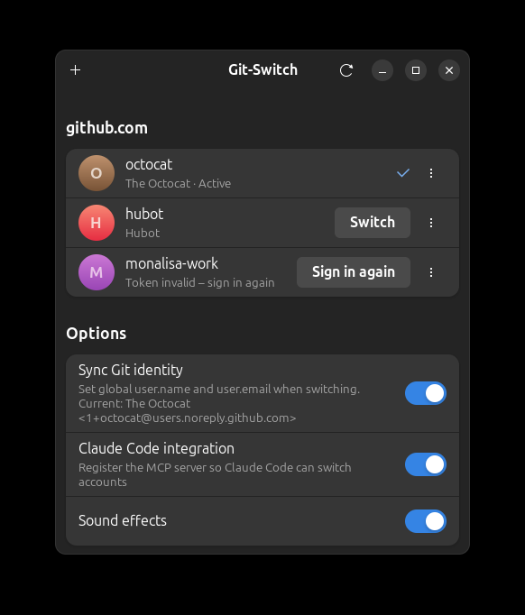

<p align="center">
  
</p>

<h1 align="center">Git-Switch</h1>

<p align="center">
  Switch between GitHub CLI accounts with one click.<br>
  <b>English</b> · <a href="README.de.md">Deutsch</a>
</p>

<p align="center">
  
</p>

A small GTK app around `gh auth switch`: see every account the
[GitHub CLI](https://cli.github.com) is logged in to and switch between them
with one click – from the window, from the command line, or from Claude Code
through the bundled MCP server.

## Features

- Lists all accounts per host, with avatar, active marker and a live check
  whether the stored token still works
- One-click switching (`gh auth switch`)
- Add accounts through a guided dialog: GitHub.com, GitHub Enterprise or a
  Forgejo/Gitea server, sign in in the browser or with an access token – no
  terminal needed
- Forgejo and Gitea accounts with the same safeguards gh applies to GitHub
  tokens (see below)
- Sign out of single accounts
- Shows the permissions (scopes) of each token; add or remove them by ticking
  boxes in a list with descriptions (`gh auth refresh`)
- Copy an account's token to the clipboard (`gh auth token`)
- Per host: choose HTTPS or SSH as git protocol and set up gh as git
  credential helper (`gh auth setup-git`)
- Optional: keep the global git `user.name` / `user.email` in sync with the
  active account (uses the account's GitHub noreply address)
- Follows changes made elsewhere (the `gh` CLI, the MCP server) immediately
- MCP server so Claude Code can list and switch accounts
- Soft sound effects for switching, sign-in and errors (can be turned off)
- English and German interface

GitHub accounts are managed through the GitHub CLI; Forgejo and Gitea accounts
are managed by Git-Switch itself. GitLab is not supported.

## Install

Requires `gh` ≥ 2.40, `git`, Python ≥ 3.10, GTK 4 and libadwaita ≥ 1.4.
Forgejo/Gitea accounts additionally need libsecret and a running keyring
(GNOME Keyring, KWallet or similar).

**Debian / Ubuntu / Linux Mint** – download the `.deb` from the
[releases page](../../releases) and install it:

```bash
sudo apt install ./gitswitch_0.3.0_all.deb
```

**Other distributions** – install PyGObject, GTK 4 and libadwaita from your
package manager, then:

```bash
pipx install --system-site-packages gitswitch-0.3.0-py3-none-any.whl
```

**From source** – `python3 -m gitswitch` inside a checkout.

## Usage

```bash
gitswitch                 # open the window
gitswitch list            # accounts as JSON
gitswitch switch <user>   # switch from the shell
```

## Forgejo and Gitea

Choose **Forgejo or Gitea** in the add-account dialog, enter the server address
and paste an access token (permissions `read:user` and `write:repository`).
Git-Switch reads the account name from the server, so there is nothing else to
type.

Tokens are handled the way gh handles GitHub tokens:

- A token is stored in the system keyring only – never in a file, in the git
  configuration, in a command line or in a log. Without a keyring the account
  is not added; there is no plain-text fallback.
- git gets it through a credential helper (`gitswitch git-credential`) that is
  set up for that one host. It answers only HTTPS requests for exactly that
  host, with the token of the active account.
- Git-Switch sends a token only to its own server, only over HTTPS, and never
  follows redirects while doing so.
- Tokens are not shown in the window and not returned by the command line or
  the MCP server.
- With **Sync Git identity**, the address `login@noreply.<host>` is used, not
  your real one. If your server uses a different no-reply domain, commits are
  simply not linked to the account.

A user name in a remote URL (`https://name@git.example.com/…`) selects that
account for the repository regardless of which one is active.

## Claude Code integration

Turn on **Claude Code integration** in the window, or register the server
yourself:

```bash
claude mcp add --scope user gitswitch -- gitswitch-mcp
```

Restart Claude Code afterwards. Two tools become available:

| Tool | Purpose |
| --- | --- |
| `list_github_accounts` | All accounts per host (GitHub, Forgejo, Gitea), the active one, token validity and scopes |
| `switch_github_account` | Activate an account (`user`, optional `hostname`) |

The tool names date from the GitHub-only versions; both tools cover Forgejo
and Gitea accounts too. Switching is global: it changes the account for every
`gh` and `git` (HTTPS) process on the machine. The server never returns tokens.

## Development

```bash
python3 -m unittest discover -s tests
packaging/make-sounds.py   # regenerate the sound effects
packaging/update-translations.sh   # extract program texts, update and compile the catalogs
packaging/build-deb.sh
packaging/mirror-releases.py <github owner/repo> <forgejo host> <forgejo owner/repo>   # copy releases to a Forgejo mirror
```

Program texts live in gettext catalogs under `gitswitch/locale/`; English is
the source language and the fallback. To add a language, copy
`gitswitch.pot` to `<lang>/LC_MESSAGES/gitswitch.po`, translate it and run
`packaging/update-translations.sh`.

## License

MIT
